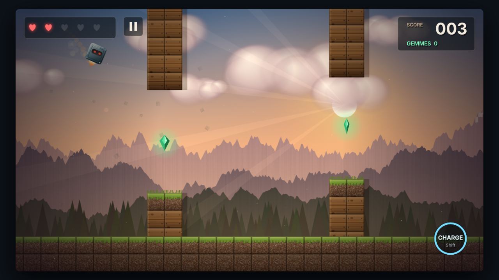

# Cubey Craft

Jeu d'arcade en navigateur : pilote un petit drone-cube entre des colonnes de blocs, ramasse des gemmes et débloque des personnages aux capacités uniques.

**▶ Jouer : https://hibaelotmani31.github.io/cubey-craft/**

## Fonctionnalités

- **5 personnages**, chacun avec une capacité spéciale : Charge (brise le bois), Ruée dorée (aspire les gemmes), Phase (traverse les colonnes 5 s), Bond quantique (téléportation), Onde de choc (pulvérise la pierre)
- **4 biomes** qui s'enchaînent tous les 25 points : forêt, désert venteux, grotte obscure, sommets à gravité réduite
- **Combos** de passages parfaits jusqu'à x5, bonus (bouclier, ralenti, aimant, vie)
- **Boutique** de skins payés en gemmes, progression sauvegardée
- Cycle jour → crépuscule lié au score, parallaxe sur 5 couches, particules, éclairage dynamique
- Musique et effets sonores générés en temps réel (Web Audio API)
- Jouable au clavier, à la souris et au tactile

## Stack technique

- HTML5 Canvas 2D et JavaScript vanilla, **aucune dépendance, aucun build**
- Textures procédurales pré-rendues sur des canvas hors écran
- Boucle de jeu à pas de temps variable (même vitesse à 60 Hz et 120 Hz)
- Synthèse audio (oscillateurs, bruit filtré, réverbération par convolution)
- Sauvegarde locale via `localStorage`

## Commandes

| Action | Clavier | Tactile |
|---|---|---|
| Voler | Espace / ↑ / W | Toucher l'écran |
| Capacité | Shift / D | Bouton rond |
| Pause | P | Bouton pause |
| Accueil | H / Échap | Bouton Accueil |
| Changer de skin | ← → puis Entrée | Flèches à l'écran |

## Lancer en local

Ouvre simplement `index.html` dans un navigateur.

## Auteur

**Hiba El Otmani** — étudiante ingénieure Software Engineering à l'ESIEA.

© 2026 Hiba El Otmani. Tous droits réservés.
